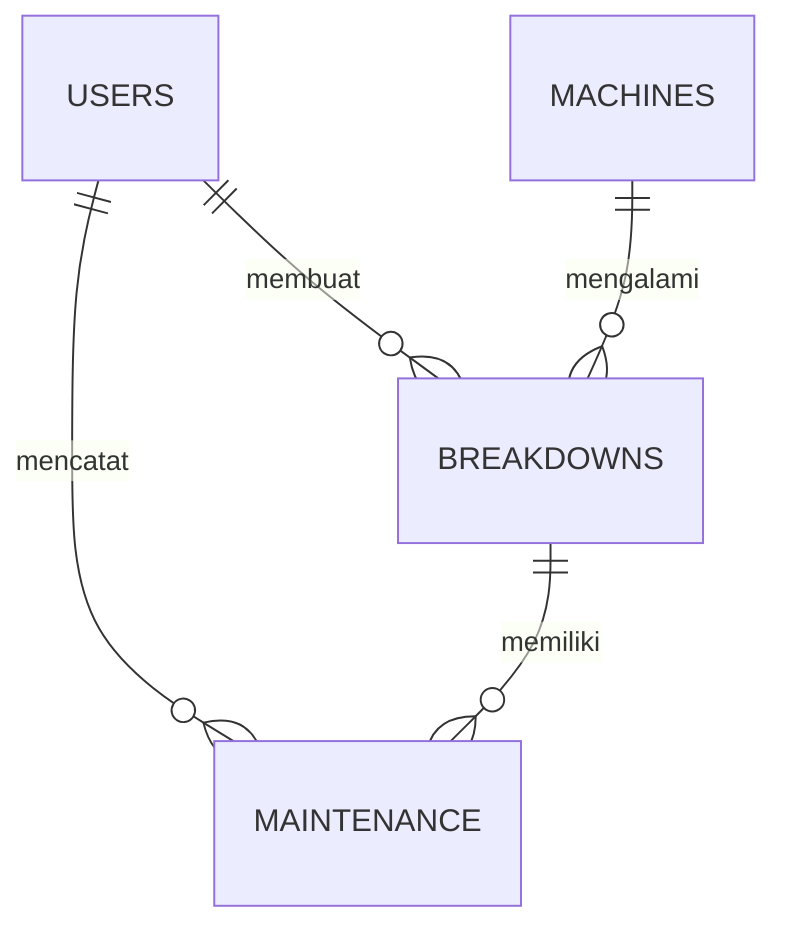
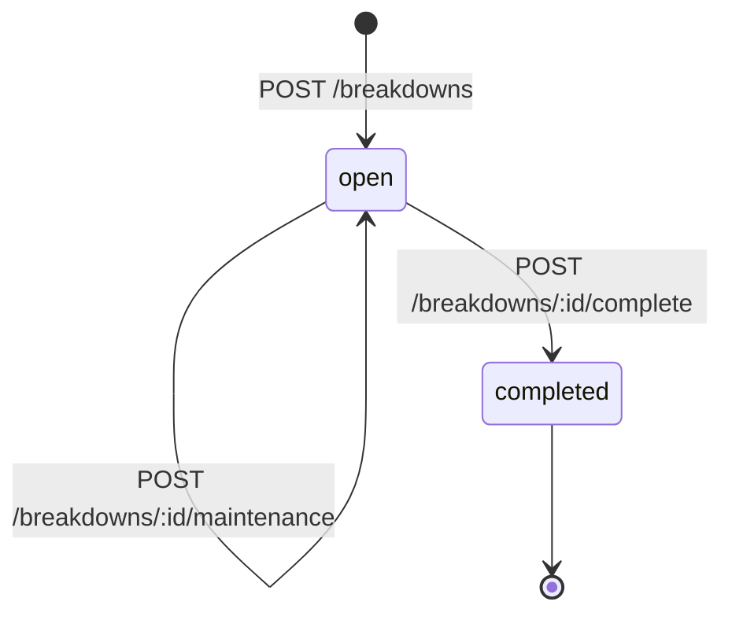

# SPEC — Sistem Monitoring Kerusakan Mesin dan *Downtime* Berbasis Web

| Atribut | Keterangan |
|---|---|
| Versi | 1.0 (draf awal untuk disepakati tim) |
| Proyek | *Capstone* Solusi TIK |
| Tim | 4 anggota (Anggota 1–4) |
| Durasi | 8 minggu |
| Dokumen terkait | `BRD.docx`, `DFD.docx` |

> Dokumen ini adalah **sumber acuan teknis tunggal** (*single source of truth*) untuk ERD, API, *frontend*, dan pengujian. Sesuai kesepakatan tim, perubahan *requirement* harus disetujui bersama sebelum mengubah ERD atau API *contract*.

---

## 1. Ringkasan Sistem

Aplikasi web yang digunakan petugas *maintenance* untuk mencatat kerusakan mesin, mencatat tindakan perbaikan, menghitung *downtime* secara otomatis, menyimpan riwayat, dan memantau kondisi mesin melalui *dashboard*.

**Alur utama:**

```
LAPOR (lisan) → CATAT → PERBAIKI → SELESAI → HITUNG DOWNTIME → SIMPAN HISTORY → MONITOR
```

## 2. Tujuan dan Ruang Lingkup

### 2.1 Tujuan
1. Mengganti pencatatan manual (lisan, Excel, kertas) dengan pencatatan digital yang terstruktur.
2. Menghitung *downtime* secara otomatis dan konsisten.
3. Menyediakan riwayat dan *dashboard* untuk analisis frekuensi kerusakan dan total *downtime*.

### 2.2 Dalam Lingkup (*In Scope*)
- *Login* dan autentikasi.
- Kelola data mesin.
- Pencatatan kerusakan.
- Pencatatan tindakan *maintenance*.
- Penyelesaian kerusakan dan perhitungan *downtime* otomatis.
- Riwayat kerusakan dengan filter (periode, *line*, mesin).
- *Dashboard* dan *monitoring*.

### 2.3 Di Luar Lingkup (*Out of Scope*)
Pengendalian mesin langsung, integrasi IoT/sensor, *predictive maintenance*, inventaris suku cadang, *preventive maintenance* otomatis, aplikasi *mobile*, notifikasi WhatsApp, dan integrasi ERP.

## 3. Aktor

| Aktor | Peran | Hak Akses |
|---|---|---|
| Petugas *Maintenance* | Pengguna utama sistem | Akses penuh ke semua fitur |
| Operator / *Line Leader* | Sumber laporan kerusakan (lisan) | **Di luar sistem**; tidak memiliki akun |

## 4. Arsitektur

```
[ Frontend (Web Browser) ]  ⇄ HTTP/HTTPS (JSON) ⇄  [ Backend / REST API ]  ⇄ Query (ORM) ⇄  [ Database MySQL ]
  UI/UX, HTTP client,                                  Autentikasi, business logic,             Users, Machines,
  state management                                     hitung downtime, CRUD                    Breakdowns, Maintenance
```

| Lapisan | Tanggung jawab | PIC |
|---|---|---|
| *Frontend* | Form, *dashboard*, riwayat, filter, *state management* | Anggota 4 |
| *Backend* / API | Validasi, autentikasi, *business logic*, perhitungan *downtime* | Anggota 3 |
| *Database* | Skema, relasi, *migration*, *seed* | Anggota 2 |

> *Stack* teknologi spesifik (bahasa/*framework* *backend* dan *frontend*) **belum ditetapkan** pada dokumen sumber; isi pada bagian 15 setelah disepakati.

## 5. Kebutuhan Fungsional

| ID | Kebutuhan | Prioritas |
|---|---|---|
| FR-01 | Petugas dapat *login* dengan *username* dan *password*; sistem mengembalikan *token*. | Wajib |
| FR-02 | Petugas dapat *logout* dan melihat profil sendiri (`/auth/me`). | Wajib |
| FR-03 | Petugas dapat menambah, melihat, mengubah, dan menghapus data mesin. | Wajib |
| FR-04 | Petugas dapat mencatat kerusakan mesin (mesin, masalah, penyebab, waktu mulai berhenti). | Wajib |
| FR-05 | Petugas dapat melihat daftar dan detail kerusakan serta mengubahnya selama belum selesai. | Wajib |
| FR-06 | Petugas dapat mencatat satu atau lebih tindakan *maintenance* pada suatu kerusakan (tindakan, komponen diganti, catatan). | Wajib |
| FR-07 | Petugas dapat mengubah catatan *maintenance*. | Wajib |
| FR-08 | Petugas dapat menyelesaikan kerusakan dengan mengisi waktu mesin kembali beroperasi; sistem menghitung *downtime* otomatis. | Wajib |
| FR-09 | Sistem menyimpan seluruh data sebagai riwayat. | Wajib |
| FR-10 | Petugas dapat melihat riwayat dengan filter periode, *line*, dan mesin. | Wajib |
| FR-11 | *Dashboard* menampilkan ringkasan: total kerusakan, total *downtime*, mesin paling sering rusak. | Wajib |
| FR-12 | *Dashboard* menampilkan data *downtime* dan frekuensi kerusakan per mesin/periode. | Wajib |

## 6. Kebutuhan Non-Fungsional

| ID | Kategori | Kebutuhan |
|---|---|---|
| NFR-01 | Keamanan | *Password* disimpan sebagai *hash* (misalnya *bcrypt*); semua *endpoint* selain *login* wajib *token* valid. |
| NFR-02 | Keamanan | Komunikasi melalui HTTPS pada lingkungan produksi/demo. |
| NFR-03 | Kegunaan | Antarmuka sederhana; fitur utama dapat dijalankan petugas tanpa pelatihan panjang. |
| NFR-04 | Kinerja | Halaman utama dan *endpoint* daftar memuat data < 3 detik pada data uji (target tim, dapat disesuaikan). |
| NFR-05 | Integritas data | Relasi *foreign key* ditegakkan; *downtime* tidak boleh bernilai negatif. |
| NFR-06 | Kompatibilitas | Berjalan pada peramban modern (*Chrome*, *Edge*, *Firefox*). |
| NFR-07 | Keterpeliharaan | Kode terstruktur per modul; dokumentasi API dan diagram diperbarui bila implementasi berubah. |

## 7. Aturan Bisnis

| ID | Aturan |
|---|---|
| BR-01 | Kerusakan hanya dapat dibuat untuk mesin yang terdaftar. |
| BR-02 | Kerusakan baru berstatus `open`; setelah diselesaikan berstatus `completed`. |
| BR-03 | Tindakan *maintenance* hanya dapat ditambahkan pada kerusakan berstatus `open`. |
| BR-04 | Waktu mesin kembali beroperasi (`completed_at`) harus lebih besar dari waktu mulai berhenti (`started_at`). |
| BR-05 | *Downtime* (menit) = `completed_at` − `started_at`, dihitung otomatis oleh *backend* dan tidak dapat diinput manual. |
| BR-06 | Saat kerusakan dibuat, status mesin menjadi `down`; saat kerusakan selesai, status mesin kembali `active`. *(asumsi desain, lihat bagian 15)* |
| BR-07 | Kerusakan berstatus `completed` tidak dapat diubah. *(asumsi desain)* |
| BR-08 | Penyelesaian kerusakan mensyaratkan minimal satu catatan *maintenance*. *(asumsi desain)* |
| BR-09 | Mesin yang memiliki riwayat kerusakan tidak boleh dihapus permanen (gunakan status `inactive`). *(asumsi desain)* |

## 8. Model Data (Usulan untuk ERD)



### 8.1 `users`
| Kolom | Tipe | Keterangan |
|---|---|---|
| id | INT, PK, AI | |
| username | VARCHAR(50), UNIQUE | |
| password_hash | VARCHAR(255) | |
| name | VARCHAR(100) | |
| role | VARCHAR(30) | nilai awal: `maintenance` |
| created_at | DATETIME | |

### 8.2 `machines`
| Kolom | Tipe | Keterangan |
|---|---|---|
| id | INT, PK, AI | |
| machine_code | VARCHAR(30), UNIQUE | contoh: `M001` |
| name | VARCHAR(100) | contoh: `Mesin Packing` |
| line | VARCHAR(50) | contoh: `Line A` |
| status | ENUM(`active`,`down`,`inactive`) | default `active` |
| created_at, updated_at | DATETIME | |

### 8.3 `breakdowns`
| Kolom | Tipe | Keterangan |
|---|---|---|
| id | INT, PK, AI | |
| machine_id | INT, FK → machines.id | wajib |
| problem | VARCHAR(255) | contoh: `Mesin berhenti` |
| cause | VARCHAR(255) | contoh: `Motor error` |
| started_at | DATETIME | waktu mulai berhenti |
| completed_at | DATETIME, NULL | waktu kembali beroperasi |
| downtime_minutes | INT, NULL | diisi saat selesai |
| status | ENUM(`open`,`completed`) | default `open` |
| created_by | INT, FK → users.id | |
| created_at, updated_at | DATETIME | |

### 8.4 `maintenance`
| Kolom | Tipe | Keterangan |
|---|---|---|
| id | INT, PK, AI | |
| breakdown_id | INT, FK → breakdowns.id | wajib |
| action | VARCHAR(255) | contoh: `Ganti bearing` |
| component_replaced | VARCHAR(150), NULL | contoh: `Bearing 6205` |
| notes | TEXT, NULL | |
| user_id | INT, FK → users.id | petugas pelaksana |
| created_at, updated_at | DATETIME | |

## 9. Siklus Status



| Objek | Status | Pemicu |
|---|---|---|
| Mesin | `active` → `down` | Kerusakan dicatat |
| Mesin | `down` → `active` | Kerusakan diselesaikan |
| Kerusakan | `open` → `completed` | Penyelesaian + perhitungan *downtime* |

## 10. Kontrak API (REST, JSON)

**Konvensi umum**
- *Base path*: `/api`. *Header* autentikasi: `Authorization: Bearer <token>` (kecuali `login`).
- Format sukses: `{ "success": true, "data": ..., "message": "..." }`
- Format galat: `{ "success": false, "message": "...", "errors": { "field": "..." } }`
- Format waktu: ISO 8601 (contoh `2025-05-01T08:10:00`). *Downtime* dalam **menit**.

### 10.1 Daftar *Endpoint*

| Modul | Method | Endpoint | Deskripsi | Status Sukses |
|---|---|---|---|---|
| Auth | POST | `/api/auth/login` | *Login* | 200 |
| Auth | POST | `/api/auth/logout` | *Logout* | 200 |
| Auth | GET | `/api/auth/me` | Profil pengguna aktif | 200 |
| Machine | GET | `/api/machines` | Daftar mesin | 200 |
| Machine | GET | `/api/machines/:id` | Detail mesin | 200 |
| Machine | POST | `/api/machines` | Tambah mesin | 201 |
| Machine | PUT | `/api/machines/:id` | Ubah mesin | 200 |
| Machine | DELETE | `/api/machines/:id` | Hapus mesin | 200 |
| Breakdown | GET | `/api/breakdowns` | Daftar kerusakan | 200 |
| Breakdown | GET | `/api/breakdowns/:id` | Detail kerusakan | 200 |
| Breakdown | POST | `/api/breakdowns` | Catat kerusakan | 201 |
| Breakdown | PUT | `/api/breakdowns/:id` | Ubah kerusakan | 200 |
| Maintenance | POST | `/api/breakdowns/:id/maintenance` | Tambah tindakan | 201 |
| Maintenance | PUT | `/api/maintenance/:id` | Ubah tindakan | 200 |
| Complete | POST | `/api/breakdowns/:id/complete` | Selesaikan kerusakan | 200 |
| Dashboard | GET | `/api/dashboard/summary` | Ringkasan | 200 |
| Dashboard | GET | `/api/dashboard/downtime` | *Downtime* per mesin/periode | 200 |
| Dashboard | GET | `/api/dashboard/frequency` | Frekuensi kerusakan | 200 |
| History | GET | `/api/history` | Riwayat (filter) | 200 |

### 10.2 Contoh *Request* dan *Response*

**a. *Login*** — `POST /api/auth/login`
```json
// Request
{ "username": "admin", "password": "123456" }

// Response 200
{ "success": true,
  "token": "eyJhbGciOi...",
  "user": { "id": 1, "name": "maintenance", "role": "maintenance" } }

// Response 401
{ "success": false, "message": "Username atau password salah" }
```

**b. Daftar mesin** — `GET /api/machines`
```json
{ "success": true,
  "data": [ { "id": 1, "machine_code": "M001", "name": "Mesin Packing", "line": "Line A", "status": "active" } ] }
```

**c. Catat kerusakan** — `POST /api/breakdowns`
```json
// Request
{ "machine_id": 1, "problem": "Mesin berhenti", "cause": "Motor error", "started_at": "2025-05-01T08:10:00" }

// Response 201
{ "success": true, "data": { "id": 15, "status": "open" } }
```

**d. Tambah *maintenance*** — `POST /api/breakdowns/15/maintenance`
```json
// Request
{ "action": "Ganti bearing", "component_replaced": "Bearing 6205", "notes": "Normal", "user_id": 1 }

// Response 201
{ "success": true, "data": { "id": 8 }, "message": "Maintenance berhasil dicatat" }
```

**e. Selesaikan kerusakan** — `POST /api/breakdowns/15/complete`
```json
// Request
{ "completed_at": "2025-05-01T09:00:00" }

// Response 200
{ "success": true, "data": { "id": 15, "status": "completed", "downtime_minutes": 50 } }
```

**f. Ringkasan *dashboard*** — `GET /api/dashboard/summary`
```json
{ "success": true,
  "data": { "total_breakdowns": 12, "total_downtime": 540, "machine_most_broken": "M001" } }
```

**g. Riwayat** — `GET /api/history?start_date=2025-05-01&end_date=2025-05-31&machine_id=1`
```json
{ "success": true,
  "data": [ { "machine_name": "Mesin Packing", "problem": "Mesin berhenti", "downtime": 50, "status": "completed" } ] }
```

> Nilai pada contoh bersifat ilustratif (diambil dari rancangan awal tim). Parameter *query* tambahan untuk `GET /api/history`: `line`, `status`, `page`, `limit`.

### 10.3 Validasi dan Kode Galat

| Kode | Kondisi | Contoh Pesan |
|---|---|---|
| 400 | Data wajib kosong / format salah | "machine_id wajib diisi" |
| 401 | *Token* tidak ada / tidak valid / kedaluwarsa | "Tidak terautentikasi" |
| 404 | Data tidak ditemukan | "Kerusakan tidak ditemukan" |
| 409 | Konflik status | "Kerusakan sudah selesai" |
| 422 | Aturan bisnis dilanggar | "Waktu selesai harus setelah waktu mulai" |
| 500 | Galat server | "Terjadi kesalahan pada server" |

## 11. Spesifikasi Perhitungan *Downtime*

```
downtime_minutes = ROUND( (completed_at - started_at) dalam detik / 60 )
```

Contoh: `started_at = 2025-05-01 08:10`, `completed_at = 2025-05-01 09:00` → **50 menit**.

*Dashboard*: `total_downtime = SUM(downtime_minutes)` untuk kerusakan berstatus `completed` pada periode terpilih; frekuensi = `COUNT(*)` per mesin.

## 12. Spesifikasi Antarmuka (*Frontend*)

| Halaman | Isi Utama | Endpoint |
|---|---|---|
| *Login* | Form *username*/*password* | `/auth/login` |
| *Dashboard* | Kartu ringkasan, grafik *downtime* dan frekuensi, filter | `/dashboard/*` |
| Data Mesin | Tabel, tambah/ubah/hapus | `/machines` |
| Kerusakan | Daftar, form catat, detail, tombol selesaikan | `/breakdowns`, `/complete` |
| *Maintenance* | Form dan daftar tindakan per kerusakan | `/breakdowns/:id/maintenance`, `/maintenance/:id` |
| Riwayat | Tabel dengan filter periode, *line*, mesin | `/history` |

## 13. Diagram Terkait

Lihat `DFD.docx`: DFD Level 0 (Diagram Konteks), Level 1, dan Level 2 untuk Proses 5.0 (Selesaikan Kerusakan dan Hitung *Downtime*).

## 14. Kriteria Penerimaan (*Acceptance Criteria*)

| ID | Skenario | Hasil yang Diharapkan |
|---|---|---|
| AC-01 | *Login* dengan kredensial benar | *Token* diterima, masuk ke *dashboard* |
| AC-02 | *Login* dengan kredensial salah | Pesan galat, tidak masuk |
| AC-03 | Catat kerusakan valid | Kerusakan berstatus `open`, mesin berstatus `down` |
| AC-04 | Tambah *maintenance* pada kerusakan `open` | Data tersimpan dan tampil pada detail |
| AC-05 | Selesaikan dengan waktu valid | Status `completed`, *downtime* terhitung benar, mesin `active` |
| AC-06 | Selesaikan dengan `completed_at` ≤ `started_at` | Ditolak (422) |
| AC-07 | Filter riwayat berdasarkan periode/*line*/mesin | Hanya data yang sesuai yang tampil |
| AC-08 | *Dashboard* periode tertentu | Total *downtime* dan frekuensi sesuai data riwayat |
| AC-09 | Akses *endpoint* tanpa *token* | Ditolak (401) |

**Strategi pengujian** (Anggota 4): *test case* fitur utama, *integration testing* *Frontend*–API–*Database*, pencatatan *bug*, *retest* sebelum demonstrasi.

## 15. Asumsi dan Hal yang Perlu Disepakati

Item berikut tidak tertulis eksplisit pada dokumen sumber dan perlu dikonfirmasi tim:

1. *Stack* teknologi *backend* dan *frontend*.
2. BR-06 s.d. BR-09 (status mesin otomatis, kerusakan selesai tidak dapat diubah, wajib ada *maintenance* sebelum selesai, mesin berriwayat tidak dihapus permanen).
3. Satuan *downtime* menit dan pembulatan ke menit terdekat.
4. Apakah `started_at` diisi petugas (waktu kejadian dilaporkan) atau otomatis waktu *input*; disarankan dapat diedit karena laporan masuk secara lisan.
5. Pembuatan akun pengguna (*seed* manual atau halaman registrasi); rancangan awal hanya mencakup *login*.
6. *Endpoint* `GET /api/dashboard/downtime` dan `/frequency` mengikuti daftar minimal pada pembagian tugas; format respons ditetapkan Anggota 3 bersama Anggota 4.

## 16. Jadwal Ringkas (8 Minggu)

| Minggu | Target |
|---|---|
| M1 | Masalah, proses bisnis, kebutuhan awal, hasil wawancara terdokumentasi |
| M2 | *Requirement* dan rancangan awal; *Use Case* dan *wireframe* |
| M3 | ERD dan diagram sistem; *database* dan *backend* dimulai |
| M4 | *Database* siap; API inti; UI dimulai |
| M5 | Fitur utama *backend* dan *frontend* berjalan terpisah |
| M6 | Integrasi; *dashboard*, riwayat, filter stabil |
| M7 | *Testing* utama, perbaikan *bug*, penyempurnaan KARIL/PPT |
| M8 | Final *testing*, KARIL, PPT, demo, presentasi |

## 17. Pembagian Tanggung Jawab

| Anggota | Peran | Keluaran Utama |
|---|---|---|
| Anggota 1 | *System Analyst* + UI/UX + PPT | *Requirement*, *Use Case*, *user flow*, *wireframe*, PPT |
| Anggota 2 | *Database* + *System Design* | ERD, DFD, *Activity*/*Sequence Diagram*, skema, *data dictionary* |
| Anggota 3 | *Backend* + API | Autentikasi, API, *business logic*, dokumentasi API |
| Anggota 4 | *Frontend* + *Integration* + *Testing* | UI, integrasi, *test case*, perbaikan *bug* |
