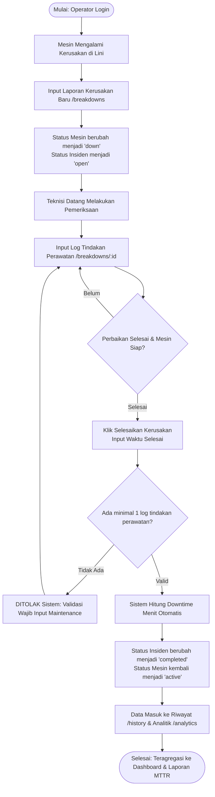
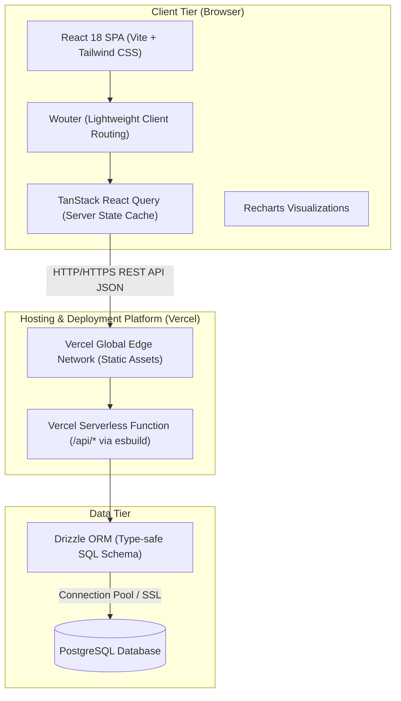
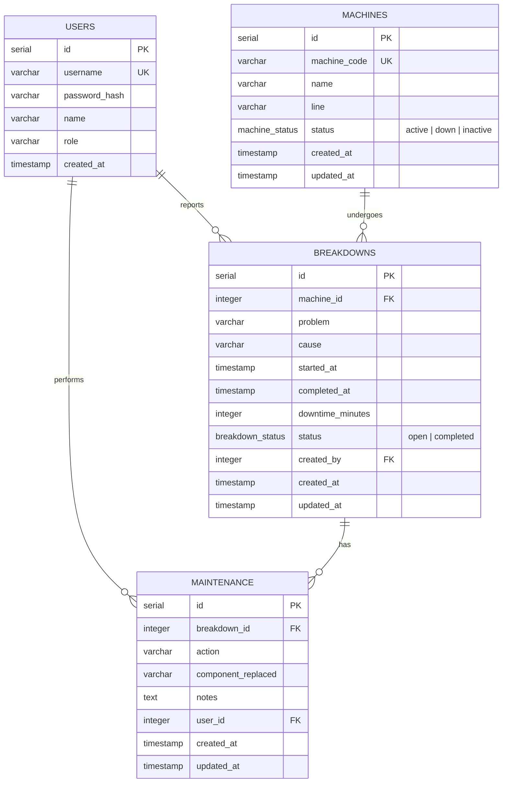

# DOKUMENTASI SISTEM MAINT-SCREEN (MAINTENANCE MONITORING AND DOWNTIME MANAGEMENT SYSTEM)

**MAINT-SCREEN** (*Maintenance Monitoring and Downtime Management System*) adalah sistem informasi berbasis web terintegrasi untuk pencatatan, pemantauan waktu henti (*downtime*), evaluasi tindakan pemeliharaan (*maintenance*), dan analisis performa mesin produksi secara *real-time*.

---

## 1. Inti Sistem (System Core Overview)

### 1.1 Latar Belakang & Masalah
Dalam lingkungan manufaktur modern, insiden kerusakan mesin yang tidak tercatat secara terstandarisasi menimbulkan sejumlah kendala operasional:
- Perhitungan waktu henti (*downtime*) dilakukan secara manual sehingga rentan terjadi bias durasi.
- Riwayat perbaikan dan penggantian suku cadang sering tercecer dan tidak terhubung langsung dengan insiden kerusakan terkait.
- Manajemen kesulitan memperoleh metrik kinerja perawatan seperti **MTTR (*Mean Time To Repair*)** dan frekuensi kerusakan mesin per lini produksi secara cepat dan akurat.

### 1.2 Tujuan & Solusi
Sistem dirancang untuk mendigitalkan seluruh siklus hidup pelaporan gangguan mesin pabrik:
1. **Pencatatan Insiden Terpusat:** Operator atau teknisi dapat segera melaporkan mesin yang berhenti (*down*), mencatat gejala masalah, dan waktu kejadian.
2. **Kalkulasi Downtime Otomatis:** Sistem secara otomatis menghitung selisih waktu antara mesin mulai rusak (*started_at*) hingga selesai perbaikan (*completed_at*) dalam satuan menit, mengeliminasi kesalahan perhitungan manual.
3. **Prasyarat Tindakan Perawatan (*Enforced Maintenance Record*):** Insiden kerusakan tidak dapat ditutup (*completed*) sebelum teknisi menginputkan minimal satu tindakan perbaikan riil beserta suku cadang yang diganti.
4. **Agregasi Metrik & Visualisasi:** Menghitung total waktu henti, MTTR, tren frekuensi kerusakan, serta menyediakan ekspor laporan terfilter untuk evaluasi berkala manajemen.

---

## 2. Alur Sistem (System Flow & Lifecycle)

Siklus penanganan kerusakan mesin di dalam sistem terbagi menjadi 4 tahap utama:

### 2.1 Rincian Tahap Operasional

#### Tahap 1: Pelaporan Kerusakan (Incident Reporting)
- Operator/staf mengakses modul **Kerusakan** (`/breakdowns`).
- Memilih mesin yang bermasalah, memasukkan deskripsi kendala (*problem*), indikasi penyebab (*cause*), dan stempel waktu kerusakan mulai terjadi (*started_at*).
- Sistem memberlakukan validasi integritas: **Satu mesin hanya boleh memiliki 1 insiden berstatus `open` dalam satu waktu** (mencegah duplikasi laporan).
- Status mesin otomatis diperbarui menjadi `down`.

#### Tahap 2: Tindakan Perbaikan (Maintenance Logging)
- Teknisi membuka detail insiden terkait (`/breakdowns/:id`).
- Setiap penanganan dicatat secara bertahap:
  - Tindakan teknis yang dilakukan (*action*).
  - Komponen/suku cadang yang diganti (*component_replaced*).
  - Catatan teknis tambahan (*notes*).
  - Identitas teknisi penanggung jawab (*user_id*).

#### Tahap 3: Penyelesaian Insiden & Kalkulasi Otomatis (Resolution & Downtime Auto-Calculation)
- Setelah perbaikan tuntas, teknisi memilih opsi selesaikan insiden dengan menentukan waktu selesai (*completed_at*).
- **Aturan Validasi Bisnis:**
  1. Waktu selesai perbaikan harus lebih besar daripada waktu mulai kerusakan ($T_{\text{completed}} > T_{\text{started}}$).
  2. Minimal terdapat 1 rekaman tindakan *maintenance* sebelum status dapat diubah menjadi `completed`.
- Sistem menghitung durasi waktu henti secara presisi:
  $$\text{Downtime (menit)} = \left\lfloor \frac{T_{\text{completed}} - T_{\text{started}}}{60.000} \right\rfloor$$
- Status insiden bertransformasi menjadi `completed` dan status operasional unit mesin kembali normal (`active`).

#### Tahap 4: Agregasi Data & Evaluasi Kinerja (Analytics & Reporting)
- Data kerusakan terselesaikan langsung terhubung ke modul **Riwayat** (`/history`) dan **Analitik** (`/analytics`).
- Sistem mengagregasi indikator efisiensi pemeliharaan:
  $$\text{MTTR} = \frac{\sum \text{Downtime Insiden Selesai}}{\text{Jumlah Insiden Selesai}}$$

---

## 3. Desain Sistem & Arsitektur Teknis

### 3.1 Arsitektur Aplikasi (Fullstack Monorepo)

Aplikasi dibangun menggunakan arsitektur modern berbasis monorepo yang dioptimalkan untuk penyebaran di platform Vercel:

### 3.2 Spesifikasi Teknologi (Tech Stack)

| Lapisan | Teknologi | Keterangan |
|---|---|---|
| **Frontend Framework** | React 18, TypeScript, Vite | Antarmuka pengguna yang cepat, modular, dan terstruktur *per-page*. |
| **Styling & UI** | Tailwind CSS, Radix UI Primitives, Lucide Icons | Desain responsif, clean industrial theme, dan ramah pengguna. |
| **Data Fetching & Cache** | TanStack React Query v5 | Pengelolaan *server-state*, *caching*, dan revalidasi otomatis. |
| **Data Visualization** | Recharts | Render grafik batang, diagram *pie*, dan analisis Pareto interaktif. |
| **Backend Runtime** | Node.js (Vercel Serverless Functions) | Handler endpoint API modular yang dikompilasi dengan esbuild. |
| **ORM & Database Driver** | Drizzle ORM, `pg` (node-postgres) | Interaksi basis data *type-safe* dengan pencegahan SQL Injection. |
| **Database Engine** | PostgreSQL 15+ (Cloud Database) | Relasional ACID, *foreign keys*, dan *unique partial index*. |
| **Pengujian (Testing)** | Node.js Native Test Runner (`node:test`, `assert/strict`) | 34 tes otomatis mencakup 29 kasus uji spesifikasi UT. |

---

### 3.3 Desain Basis Data (Entity Relationship Model)

---

## 4. Fitur-Fitur Utama Sistem

### 4.1 Dashboard Ringkasan & Real-time KPI (`/dashboard`)
- **Kartu Metrik Utama:** Menampilkan total insiden kerusakan bulan berjalan, akumulasi waktu henti (*total downtime*), jumlah mesin aktif vs mesin *down*, dan nilai **MTTR (*Mean Time To Repair*)**.
- **Indikator Status Pabrik:** Memberikan ringkasan cepat kondisi operasional seluruh mesin di lantai produksi.
- **Daftar Kerusakan Aktif Cepat:** Memperlihatkan insiden yang saat ini berstatus `open` agar teknisi dapat segera merespons.

### 4.2 Manajemen Mesin & Lini Produksi (`/machines`)
- **Katalog Mesin:** Pencatatan kode unit mesin unik (contoh: `CNC-001`), nama mesin, lini pabrik (contoh: `Assembly Line A`), serta status kesiapan operasional (`active`, `down`, `inactive`).
- **Validasi Data Mesin:** Proteksi duplikasi kode mesin, format penamaan terstandarisasi, dan sinkronisasi status otomatis saat mesin rusak atau selesai diservis.

### 4.3 Pelaporan & Pelacakan Kerusakan (`/breakdowns`)
- **Formulir Input Insiden Cepat:** Input gangguan mesin lengkap dengan waktu mulai henti dan dugaan penyebab.
- **Pencegahan Redundansi:** Sistem menolak pembuatan insiden baru apabila mesin yang dipilih sudah berstatus `open` dalam catatan aktif.
- **Status Badge Informatif:** Pembedaan visual yang tegas antara insiden `open` (butuh perbaikan) dan `completed` (selesai).

### 4.4 Lembar Kerja Detail & Log Perawatan (`/breakdowns/:id`)
- **Audit Riwayat Tindakan Teknisi:** Menampilkan daftar kronologis tindakan perbaikan yang dilakukan untuk suatu insiden.
- **Pencatatan Suku Cadang:** Mendokumentasikan suku cadang atau komponen mesin yang diganti untuk pelacakan inventaris perawatan.
- **Tombol Penyelesaian Tervalidasi:** Memvalidasi keberadaan log perawatan sebelum mengubah status insiden dan menghitung durasi *downtime*.

### 4.5 Riwayat Insiden & Multi-Filter Data (`/history`)
- **Pencarian Komprehensif:** Filter rekonsiliasi data berdasarkan rentang tanggal (`start_date` s.d. `end_date`), lini produksi tertentu (*case-insensitive partial search*), pilihan mesin spesifik, dan status insiden.
- **Pagination Terstruktur:** Menampilkan data riwayat per halaman untuk performa pemuatan data yang optimal.
- **Ekspor Dokumen CSV:** Mengunduh berkas laporan insiden ke dalam format `.csv` (berdasarkan bulan berjalan atau rentang tanggal fleksibel) untuk kebutuhan pelaporan formal dan arsip audit.

### 4.6 Analitik Grafis & Visualisasi Performa (`/analytics`)
- **Grafik Frekuensi Kerusakan:** Diagram batang peringkat unit mesin yang paling sering mengalami kerusakan (*Top Problematic Machines*).
- **Grafik Pareto Downtime:** Mengidentifikasi mesin dengan akumulasi durasi waktu henti terlama yang paling berdampak pada penurunan kapasitas produksi.
- **Distribusi Kesiapan Mesin:** Diagram lingkaran (*pie chart*) proporsi mesin aktif, tidak aktif, dan mesin yang sedang mengalami perbaikan.

### 4.7 Autentikasi Staf & Keamanan Akses (`/login`)
- **Session Berbasis Cookie HTTP-Only:** Menjaga keamanan sesi teknisi dan operator tanpa penyimpanan token rentan di `localStorage`.
- **Enkripsi Sandi:** Penyimpanan kata sandi terproteksi dengan metode hashing yang aman.
- **Proteksi Rute Klien & Server:** Setiap akses halaman kerja dan panggilan API privat memverifikasi keberadaan sesi autentikasi yang sah.

---

## 5. Ringkasan Endpoint API Utama

| Metode | Endpoint URL | Fungsi & Deskripsi |
|---|---|---|
| `POST` | `/api/auth/login` | Autentikasi staf, validasi masukan, dan inisiasi sesi cookie. |
| `POST` | `/api/auth/logout` | Terminasi sesi aktif pengguna. |
| `GET` | `/api/auth/me` | Memeriksa status login dan mengambil profil staf aktif. |
| `GET` | `/api/machines` | Mengambil daftar seluruh unit mesin (mendukung filter `line` & `status`). |
| `POST` | `/api/machines` | Menambahkan unit mesin baru ke dalam sistem. |
| `GET` | `/api/breakdowns` | Mengambil daftar insiden kerusakan (mendukung paginasi & filter). |
| `POST` | `/api/breakdowns` | Mendaftarkan insiden kerusakan baru dan mengubah status mesin menjadi `down`. |
| `GET` | `/api/breakdowns/:id` | Mengambil detail lengkap insiden beserta riwayat *maintenance*. |
| `POST` | `/api/breakdowns/:id/complete` | Menyelesaikan insiden kerusakan dan mengalkulasi otomatis menit *downtime*. |
| `POST` | `/api/breakdowns/:id/maintenance` | Menambahkan tindakan perbaikan teknisi ke insiden yang sedang ditangani. |
| `GET` | `/api/history` | Mengambil riwayat insiden dengan filter multi-kriteria untuk tabel laporan. |
| `GET` | `/api/history/export` | Mengunduh data insiden dalam format file CSV. |
| `GET` | `/api/dashboard/summary` | Menyajikan akumulasi KPI total kerusakan, waktu henti, MTTR, dan unit aktif. |
| `GET` | `/api/dashboard/frequency` | Mengambil data seri untuk grafik frekuensi kerusakan per mesin. |
| `GET` | `/api/dashboard/downtime` | Mengambil data seri untuk grafik akumulasi durasi *downtime* per mesin. |

---

*Dokumentasi ini disusun untuk memenuhi kebutuhan laporan teknis, presentasi sistem, dan panduan arsitektur Capstone Project.*

